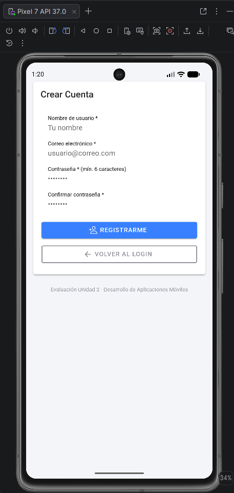
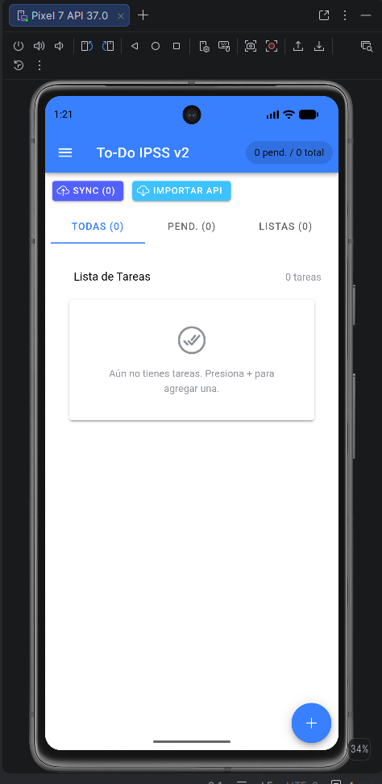
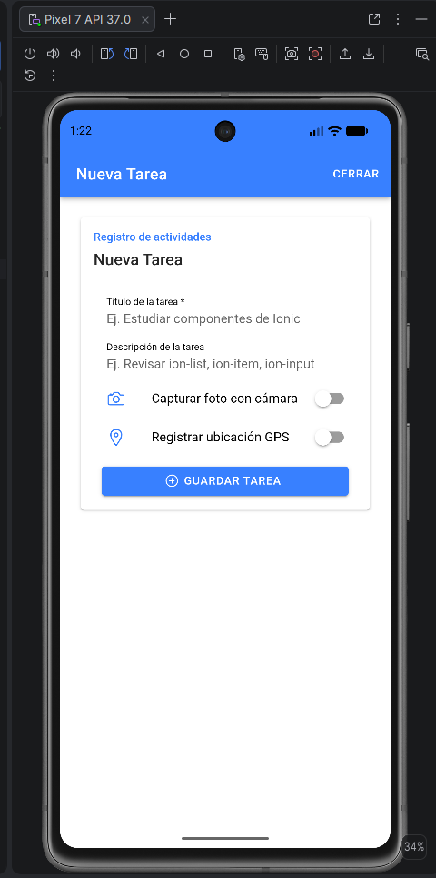
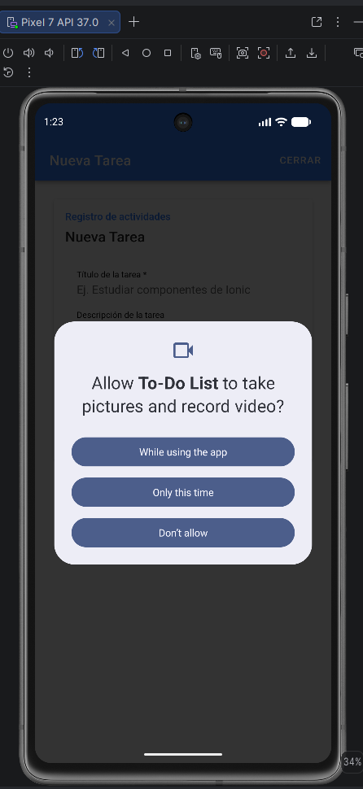
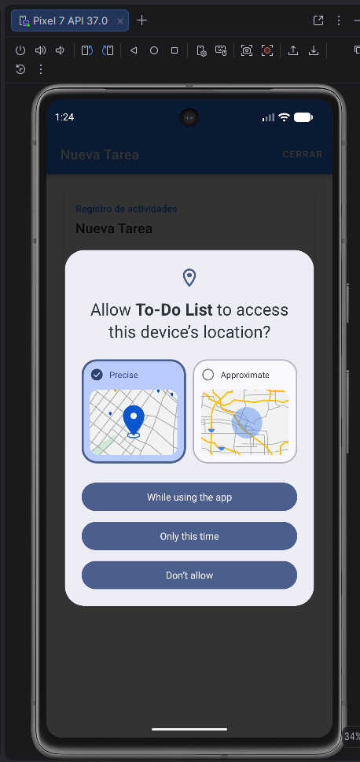
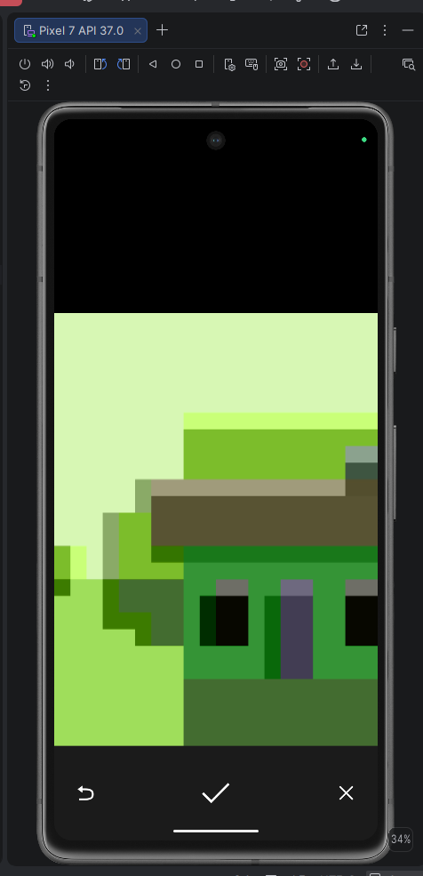
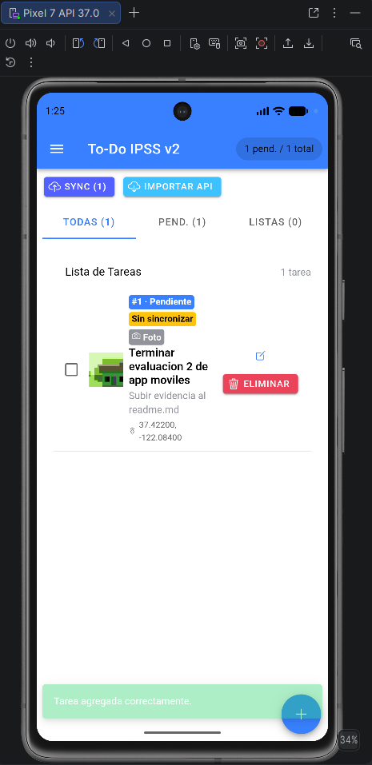
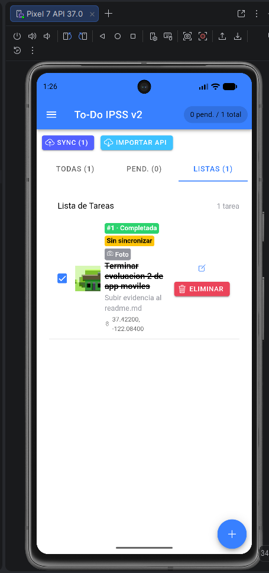
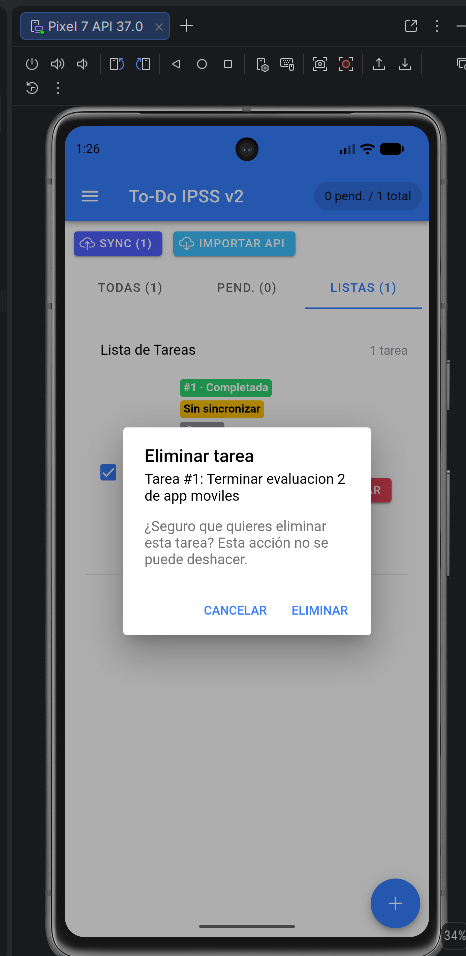
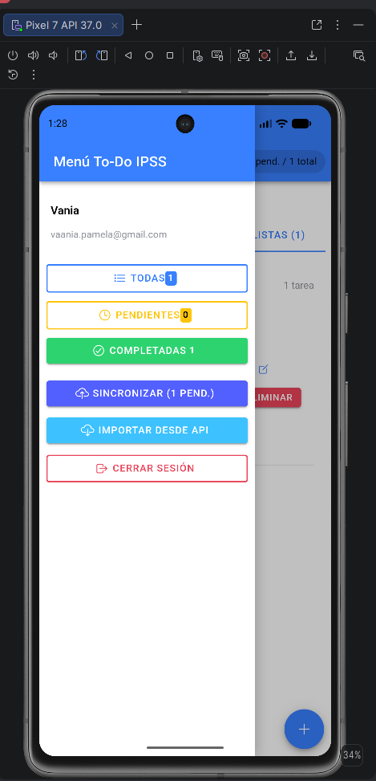

# To-Do List — Evaluación Unidad 2
## Desarrollo de Aplicaciones Móviles · Ionic + React + Capacitor

**Integrantes:** Vania Muñoz · Tolmo María

---

## 1. Descripción General

Este proyecto amplía la aplicación To-Do List de la Unidad 1 incorporando:

| Funcionalidad | Tecnología | Requisito evaluativo |
|---|---|---|
| Captura de fotos con cámara | `@capacitor/camera` | Punto 1 y 2 |
| Registro de ubicación GPS | `@capacitor/geolocation` | Punto 1 y 2 |
| Almacenamiento local offline | `@capacitor/preferences` | Punto 4 (evolución) |
| Autenticación multi-usuario | Preferences + hashing | Punto 4 (evolución) |
| Sincronización con API externa | `fetch` → JSONPlaceholder | Punto 4 y 5 |
| Importación de tareas desde API | JSONPlaceholder `/todos` | Punto 4 y 5 |
| Pruebas automatizadas (53 casos) | Vitest + Testing Library | Punto 3 y 6 |
| Permisos nativos Android/iOS | AndroidManifest + Info.plist | Punto 2 |

---

## 2. Estructura del Proyecto

```
EVU2_app/
├── app/                          ← Código fuente web (Ionic + React)
│   ├── src/
│   │   ├── components/
│   │   │   ├── formTask/         ← Formulario con toggles cámara/GPS
│   │   │   ├── listTask/         ← Lista con badges de estado sync
│   │   │   └── task/             ← Item de tarea con miniatura y coords
│   │   ├── guards/
│   │   │   ├── AuthGuard.tsx     ← Protege rutas privadas (/home)
│   │   │   └── GuestGuard.tsx    ← Bloquea login/register si ya hay sesión
│   │   ├── hooks/
│   │   │   ├── AuthContext.tsx   ← Context provider de autenticación
│   │   │   ├── useAuth.ts        ← Estado de sesión + login/logout/register
│   │   │   └── useTasks.ts       ← CRUD + cámara + GPS + sync + import
│   │   ├── pages/
│   │   │   ├── home/HomePage.tsx     ← Lista principal + FAB + modales
│   │   │   ├── login/LoginPage.tsx   ← Formulario de login
│   │   │   └── register/RegisterPage.tsx ← Formulario de registro
│   │   ├── services/
│   │   │   ├── authService.ts        ← Register/login/logout con Preferences
│   │   │   ├── storageService.ts     ← CRUD de tareas en Preferences (offline)
│   │   │   ├── cameraService.ts      ← Captura con @capacitor/camera
│   │   │   ├── geolocationService.ts ← GPS con @capacitor/geolocation
│   │   │   ├── apiService.ts         ← fetch contra JSONPlaceholder
│   │   │   └── taskService.ts        ← Orquesta CRUD + sync + import
│   │   ├── __tests__/
│   │   │   ├── cameraService.test.ts     ← 12 casos
│   │   │   ├── geolocationService.test.ts← 13 casos
│   │   │   ├── apiService.test.ts        ← 14 casos
│   │   │   └── authService.test.ts       ← 14 casos
│   │   ├── theme/variables.css      ← Paleta de colores + dark mode
│   │   ├── App.tsx                  ← Router principal + AuthProvider
│   │   ├── main.tsx                 ← Punto de entrada React
│   │   └── setupTests.ts            ← Mocks globales de Capacitor
│   ├── capacitor.config.ts
│   ├── package.json
│   ├── vite.config.ts
│   └── tsconfig.json
├── android/
│   └── app/src/main/
│       ├── AndroidManifest.xml      ← CAMERA, GPS, INTERNET, FileProvider
│       └── res/xml/file_paths.xml   ← Rutas seguras para FileProvider
└── ios/
    └── App/App/
        └── Info.plist               ← NSCamera/NSLocation/NSPhotoLibrary usage
```

---

## 3. Instalación y Ejecución

### Prerrequisitos
- Node.js ≥ 18
- npm ≥ 9
- Ionic CLI: `npm install -g @ionic/cli`
- Capacitor CLI: incluido en devDependencies

### Instalar dependencias
```bash
cd EVU2_app/app
npm install
```

### Ejecutar en navegador (desarrollo)
```bash
npm run dev
```
La app abre en `http://localhost:5173`

> **Nota:** La cámara y GPS no funcionan en navegador de escritorio.
> Para probarlos se necesita un dispositivo físico o emulador Android/iOS.

### Ejecutar pruebas automatizadas
```bash
npm run test:unit
```
Ejecuta los 53 casos de prueba con Vitest en jsdom (sin dispositivo).

### Compilar para producción
```bash
npm run build
```

### Agregar plataforma nativa y ejecutar en dispositivo
```bash
# Android
npx cap add android
npx cap sync
npx cap open android   # Abre Android Studio

# iOS (requiere macOS + Xcode)
npx cap add ios
npx cap sync
npx cap open ios
```

---

## 4. Flujo de Usuario

```
Inicio
  │
  ▼
/login ──── [Sin cuenta] ──► /register ──► crea usuario ──┐
  │                                                        │
  │ [Con cuenta]                                           │
  ▼                                                        │
Autenticación con email + contraseña                       │
  │                                                        │
  └─────────────────────────────────────────────────────────┘
  │
  ▼
/home — Lista de tareas del usuario actual
  ├── [FAB +] → Modal "Nueva Tarea"
  │             ├── Título y descripción
  │             ├── Toggle: Capturar foto con cámara  ← @capacitor/camera
  │             └── Toggle: Registrar ubicación GPS   ← @capacitor/geolocation
  │
  ├── [Sync] → Sube tareas pendientes a JSONPlaceholder
  ├── [Importar API] → Descarga tareas desde JSONPlaceholder
  │
  ├── Menú lateral
  │   ├── Filtros: Todas / Pendientes / Completadas
  │   ├── Sync y Importar
  │   └── Cerrar sesión
  │
  └── Cada tarea muestra:
      ├── Badge de estado (Pendiente / Completada)
      ├── Badge de sincronización (Sin sincronizar / Sincronizada)
      ├── Badge de foto (si tiene imagen)
      ├── Miniatura de la foto adjunta
      ├── Coordenadas GPS de creación
      └── Botones Editar / Eliminar
```

---

## 5. API Externa — JSONPlaceholder

La app usa [JSONPlaceholder](https://jsonplaceholder.typicode.com) como API de demostración:

| Operación | Método | Endpoint |
|---|---|---|
| Importar tareas | GET | `/todos?_limit=5` |
| Crear tarea remota | POST | `/todos` |
| Actualizar tarea remota | PUT | `/todos/{id}` |
| Eliminar tarea remota | DELETE | `/todos/{id}` |

> JSONPlaceholder es una API de prueba: simula las respuestas pero no persiste datos entre sesiones. En producción se reemplazaría por un backend real.

---

## 6. Permisos del Dispositivo

### Android (`AndroidManifest.xml`)
| Permiso | Plugin |
|---|---|
| `CAMERA` | @capacitor/camera |
| `READ_MEDIA_IMAGES` (Android 13+) | @capacitor/camera |
| `READ_EXTERNAL_STORAGE` (≤Android 12) | @capacitor/camera |
| `ACCESS_FINE_LOCATION` | @capacitor/geolocation |
| `ACCESS_COARSE_LOCATION` | @capacitor/geolocation |
| `INTERNET` | fetch API (sync/import) |
| `ACCESS_NETWORK_STATE` | detectar conectividad |

### iOS (`Info.plist`)
| Clave | Uso |
|---|---|
| `NSCameraUsageDescription` | Adjuntar foto a tarea |
| `NSPhotoLibraryUsageDescription` | Seleccionar foto de galería |
| `NSPhotoLibraryAddUsageDescription` | Guardar foto capturada |
| `NSLocationWhenInUseUsageDescription` | GPS al crear tarea |

---

## 7. Pruebas Automatizadas

Ejecutar con: `npm run test:unit`

| Archivo | Casos | Cubre |
|---|---|---|
| `cameraService.test.ts` | 12 | Flujo exitoso, permisos, cancelación, errores |
| `geolocationService.test.ts` | 13 | GPS exitoso, permisos, timeout, formatLocation |
| `apiService.test.ts` | 14 | Fetch/POST/PUT/DELETE, errores HTTP, timeout |
| `authService.test.ts` | 14 | Register, login, logout, sesión, multi-usuario |
| **Total** | **53** | Todos los servicios críticos |

Los plugins de Capacitor se mockean en `setupTests.ts` para que los tests
corran en entorno jsdom sin necesitar dispositivo físico ni emulador.

---

## 8. Tecnologías Utilizadas

- **Ionic Framework** v9 — componentes UI móviles
- **React** 19 — framework de frontend
- **TypeScript** 5.9 — tipado estático
- **Vite** 8 — bundler y servidor de desarrollo
- **Capacitor** 8 — acceso a APIs nativas
  - `@capacitor/camera` — cámara del dispositivo
  - `@capacitor/geolocation` — GPS
  - `@capacitor/preferences` — almacenamiento local persistente
- **Vitest** + **Testing Library** — pruebas unitarias
- **React Router** v6 — navegación SPA

## 9. Evidencias

- **Creacion de cuenta**



- **Dashboard de lista de tareas**





- **Permisos para uso de camara y gps**





- **Foto capturada para la tarea**



- **Tarea creada con éxito y posteriormente finalizada**





- **Funcion de eliminar tarea**



- **Vista de perfil con opciones de tareas, sync y cerrar sesion**


