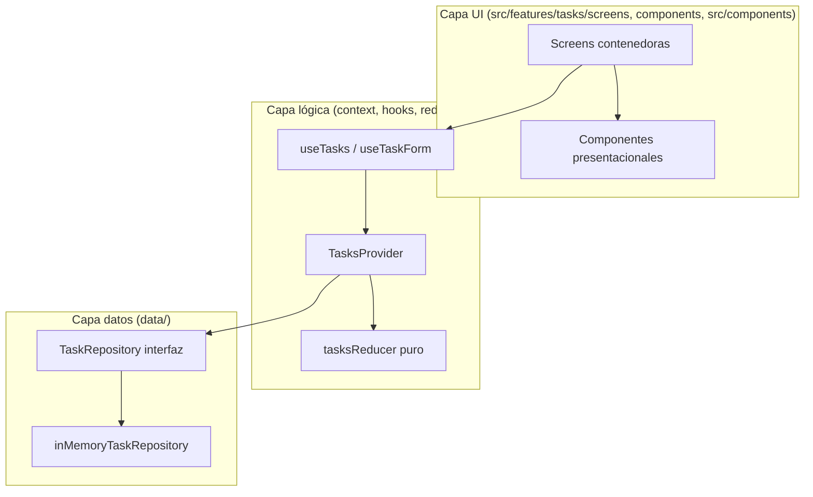
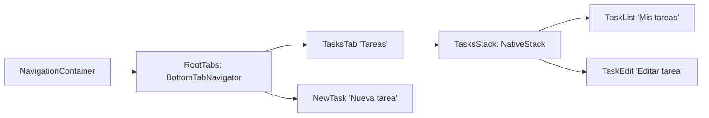

# Diseño: ToDo App en React Native (EVU1)

## Enfoque técnico

App en 3 capas (UI, lógica, datos), igual que el modelo del apunte. Las pantallas no conocen el repositorio: solo usan `useTasks()`. `TasksProvider` coordina: llama al repositorio (async) y luego despacha al reducer (puro). Cambiar a AsyncStorage (U2) o API (U4) = otra implementación de `TaskRepository`, sin tocar UI ni reducer.



Flujo de una acción (agregar): `TaskForm.onSubmit` -> `NewTaskScreen` -> `useTasks().addTask(input)` -> `repository.create(input)` -> `dispatch({ type: 'ADD_TASK', task })` -> re-render de `TaskListScreen`.

## Decisiones de arquitectura

| Decisión | Elegido | Rechazado | Por qué |
|---|---|---|---|
| Ubicación de textos UI | `src/i18n/es.ts` (objeto `as const`) | `constants/strings.ts`; `i18next` | El nombre declara el idioma y deja lugar a `en.ts`; `as const` da autocompletado y detecta claves inexistentes. Una librería i18n es costo sin necesidad en U1. |
| Repositorio async | Métodos devuelven `Promise` aun en memoria | API síncrona | AsyncStorage y fetch son async; si U1 es síncrono, U2 rompe todas las firmas. |
| Dónde nace el id | En el repositorio (`create`) | En el reducer o la pantalla | El reducer debe ser puro (sin `Date.now`/random). Con API, el id lo da el servidor: misma responsabilidad, misma capa. |
| Generación de id | `createId()` en `src/utils/createId.ts`: `Date.now().toString(36) + Math.random().toString(36).slice(2, 8)` | `uuid`; `crypto.randomUUID`; `expo-crypto` | Cero dependencias y funciona en Hermes y web. `crypto.randomUUID` no está garantizado en Hermes. Suficiente para datos locales; la API reemplaza el id en U4. |
| Filtro | En el estado global (`SET_FILTER`) + selector `selectVisibleTasks` | `useState` en la pantalla | Lógica derivada fuera de la UI, fácil de testear y citable como patrón reducer/selector. |
| Toggle completada | `toggleTask(id)` en el provider -> `repository.update` -> `UPDATE_TASK` | Acción `TOGGLE_TASK` que muta sin repositorio | El repositorio es la fuente de verdad; con persistencia, un toggle solo en memoria se perdería. |
| Un solo contexto | `TasksContext` con valor memoizado (`useMemo`) y acciones con `useCallback` | Contextos separados estado/acciones | Con una lista chica el costo de re-render es despreciable; dos contextos suman complejidad sin beneficio en U1. |
| Parámetro de edición | `TaskEdit: { taskId: string }` | Pasar el objeto `Task` | Pasar el objeto deja datos obsoletos y no es serializable para deep links; la pantalla lee el estado actual. |
| Confirmar eliminar | `confirmAsync()` en `src/utils/confirm.ts` con `Platform.OS` | `Alert.alert` directo; `Modal` propio | `Alert.alert` ignora botones en Expo web. Un wrapper con `Promise<boolean>` unifica ambas plataformas en una línea. Un `Modal` propio es más código. |
| Tras agregar | Limpiar formulario y mostrar mensaje "Tarea agregada" en la misma pestaña | Navegar a la lista | El brief pide que el formulario se limpie; si navegamos, ese comportamiento no se ve. |

### Confirmación multiplataforma (patrón no obvio)

```ts
export function confirmAsync(opts: ConfirmOptions): Promise<boolean> {
  if (Platform.OS === 'web') {
    return Promise.resolve(window.confirm(`${opts.title}\n\n${opts.message}`));
  }
  return new Promise((resolve) => {
    Alert.alert(opts.title, opts.message, [
      { text: opts.cancelText, style: 'cancel', onPress: () => resolve(false) },
      { text: opts.confirmText, style: 'destructive', onPress: () => resolve(true) },
    ], { cancelable: true, onDismiss: () => resolve(false) });
  });
}
```

## Navegación



```ts
export type TasksStackParamList = { TaskList: undefined; TaskEdit: { taskId: string } };
export type RootTabParamList = {
  TasksTab: NavigatorScreenParams<TasksStackParamList>;
  NewTask: undefined;
};
declare global {
  namespace ReactNavigation { interface RootParamList extends RootTabParamList {} }
}
```

Tabs con `headerShown: false` en `TasksTab` (el stack pone su propio header). Íconos de `@expo/vector-icons`.

## Árbol de componentes

```
App
└─ SafeAreaProvider
   └─ TasksProvider (repository = inMemoryTaskRepository)
      └─ NavigationContainer > RootNavigator (tabs)
         ├─ TasksStack
         │  ├─ TaskListScreen (contenedor)
         │  │  ├─ FilterBar (Todas / Pendientes, segmentado con Pressable)
         │  │  └─ TaskList (FlatList, keyExtractor=id) > TaskItem > Checkbox + AppButton(icon)
         │  │     └─ EmptyState (ListEmptyComponent)
         │  └─ TaskEditScreen (contenedor) > TaskForm
         └─ NewTaskScreen (contenedor) > TaskForm (presentacional, controlado)
```

`useTaskForm(initial)` maneja `title`, `description`, `error`, `validate()`, `reset()`. `TaskForm` solo recibe props y callbacks. Ambas pantallas envuelven en `KeyboardAvoidingView`.

## Contratos

```ts
export type Task = { id: string; title: string; description: string; completed: boolean; createdAt: number };
export type TaskInput = { title: string; description: string };
export type TaskFilter = 'all' | 'pending';

export interface TaskRepository {
  getAll(): Promise<Task[]>;
  create(input: TaskInput): Promise<Task>;
  update(id: string, changes: Partial<TaskInput & { completed: boolean }>): Promise<Task>;
  remove(id: string): Promise<void>;
}

export type TasksState = { tasks: Task[]; filter: TaskFilter; status: 'loading' | 'ready' };
export type TasksAction =
  | { type: 'LOAD_TASKS'; tasks: Task[] }
  | { type: 'ADD_TASK'; task: Task }
  | { type: 'UPDATE_TASK'; task: Task }
  | { type: 'DELETE_TASK'; id: string }
  | { type: 'SET_FILTER'; filter: TaskFilter };
```

`useTasks()` expone `{ tasks (visibles), allCount, filter, status, addTask, updateTask, toggleTask, deleteTask, setFilter, getTaskById }` y lanza error si se usa fuera del provider. La validación del título (`trim()` no vacío) vive en `useTaskForm` y se repite en `addTask`/`updateTask` como defensa.

## Tema y principios de UI

| Token | Valores | Principio de rúbrica |
|---|---|---|
| `spacing` | base 4: `xs 4, sm 8, md 16, lg 24, xl 32` | Ritmo (solo múltiplos de 4) y balance (padding de pantalla `md`, entre tarjetas `sm`) |
| `typography` | `title 24/700, heading 20/600, body 16/400, label 14/600, caption 12/400` | Jerarquía (título de tarea `heading`, descripción `body` muted) y proporción (escala ~1.2) |
| `colors.text` `#111827` sobre `#FFFFFF` | 17.7:1 | Contraste AA |
| `colors.textMuted` `#4B5563` | 7.6:1 | Contraste AA (descripción, completadas con tachado) |
| `colors.primary` `#1D4ED8` (texto blanco encima) | 6.7:1 | Contraste AA, acción principal destacada |
| `colors.danger` `#B91C1C` | 6.5:1 | Contraste AA, acción destructiva distinguible |
| `colors.success` `#15803D` | 5.0:1 | Mensaje "Tarea agregada" |
| `colors.border` `#6B7280` (inputs) / `colors.divider` `#E5E7EB` (decorativo) | 4.8:1 / n.a. | Contraste de componentes UI >= 3:1 |
| `colors.background` `#F9FAFB`, `surface #FFFFFF` | — | Balance figura/fondo |
| `radius` | `sm 6, md 12` | Proporción |
| `touchTarget` | `44` | Accesibilidad |

## Accesibilidad

- `minHeight/minWidth: theme.touchTarget` en `AppButton`, `Checkbox` y segmentos del filtro; `hitSlop` en botones de ícono.
- `accessibilityRole` (`button`, `checkbox`, `tab`) y `accessibilityState` (`checked`, `selected`, `disabled`).
- `accessibilityLabel` con contexto: `Eliminar tarea "${title}"`, `Editar tarea "${title}"`, `Marcar "${title}" como completada`.
- Error del título y mensaje de éxito con `accessibilityLiveRegion="polite"` (Android) y `accessibilityRole="alert"`.
- El estado no se comunica solo con color: completadas usan tachado + check.

## Cambios de archivos (todos nuevos)

| Archivo | Descripción |
|---|---|
| `App.tsx` | Providers + `NavigationContainer` |
| `app.json`, `package.json` | Expo; script `web: expo start --web --port 8100` |
| `src/navigation/RootNavigator.tsx`, `TasksStack.tsx`, `types.ts` | Tabs, stack, params tipados |
| `src/features/tasks/types.ts` | `Task`, `TaskInput`, `TaskFilter` |
| `src/features/tasks/data/TaskRepository.ts`, `inMemoryTaskRepository.ts` | Interfaz + implementación |
| `src/features/tasks/context/tasksReducer.ts`, `TasksProvider.tsx`, `selectors.ts` | Reducer, provider, `selectVisibleTasks` |
| `src/features/tasks/hooks/useTasks.ts`, `useTaskForm.ts` | Custom hooks |
| `src/features/tasks/screens/TaskListScreen.tsx`, `NewTaskScreen.tsx`, `TaskEditScreen.tsx` | Contenedores |
| `src/features/tasks/components/TaskList.tsx`, `TaskItem.tsx`, `TaskForm.tsx`, `FilterBar.tsx`, `EmptyState.tsx` | Presentacionales |
| `src/components/AppButton.tsx`, `AppTextInput.tsx`, `Checkbox.tsx` | UI reutilizable |
| `src/theme/colors.ts`, `spacing.ts`, `typography.ts`, `index.ts` | Tokens |
| `src/i18n/es.ts` | Textos UI en español |
| `src/utils/confirm.ts`, `createId.ts` | Confirmación multiplataforma, ids |

Trazabilidad Ionic -> RN: ver tabla en `proposal.md`; `AppButton` = `ion-button`, `TaskList`/`TaskItem` = `ion-list`/`ion-item`, `AppTextInput` = `ion-input`, `confirmAsync` = `ion-alert`.

## Mapa patrón -> archivo (evidencia 18 pts)

| Patrón | Archivo citable |
|---|---|
| Arquitectura en capas | `src/features/tasks/{screens,context,data}/` |
| Repository / inversión de dependencias | `data/TaskRepository.ts`, `data/inMemoryTaskRepository.ts`, inyección en `App.tsx` |
| Reducer (estado inmutable, acciones) | `context/tasksReducer.ts` |
| Context / Provider | `context/TasksProvider.tsx` |
| Custom hooks | `hooks/useTasks.ts`, `hooks/useTaskForm.ts` |
| Contenedor / presentacional | `screens/NewTaskScreen.tsx` vs `components/TaskForm.tsx` |
| Componentes controlados | `components/TaskForm.tsx`, `src/components/AppTextInput.tsx` |
| Composición | `TaskList` > `TaskItem` > `AppButton` |
| Flujo unidireccional | props hacia abajo, `onToggle`/`onDelete` hacia arriba en `TaskItem.tsx` |
| Selector / estado derivado | `context/selectors.ts` |
| Adapter de plataforma | `src/utils/confirm.ts` |
| Listas con key estable | `components/TaskList.tsx` (`keyExtractor`) |
| Design tokens | `src/theme/` |

## Estrategia de testing (solo nota, TDD estricto apagado)

| Capa | Qué | Cómo |
|---|---|---|
| Unit | `tasksReducer`, `selectVisibleTasks`, `createId` | Jest (`jest-expo`), funciones puras |
| Unit | `inMemoryTaskRepository` | Jest, CRUD async |
| Componente | `TaskForm` + `useTaskForm`: error con título vacío, limpieza tras enviar | React Native Testing Library |
| Manual | Flujo completo en web 8100 y Expo Go, incluido eliminar en web | Checklist de demo |

## Migración

No requiere migración (greenfield). U2: agregar `asyncStorageTaskRepository.ts` y cambiar la inyección en `App.tsx`.

## Preguntas abiertas

- [ ] Confirmar con specs que tras agregar se queda en "Nueva tarea" (no navega a la lista).
- [ ] Verificar el flag `--port 8100` y el SDK compatible con Expo Go al hacer el scaffolding.
